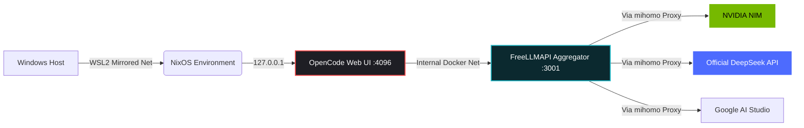

<div align="center">

# ⚡ hydr4-agent ⚡

**The Modular Weapon for the AI Rebellion.**

[](#)
[](#)
[](#)
[](#)

</div>

```text
           (\,;'\,;/)         _   _ __   __ ____  ____      _    
            \       /        | | | |\ \ / /|  _ \|  _ \    / \   
            /   _   \        | |_| | \ V / | | | | |_) |  / _ \  
           |   ( )   |       |  _  |  | |  | |_| |  _ <  / ___ \ 
            \       /        |_| |_|  |_|  |____/|_| \_\/_/   \_\
           /`\     /`\       
          /   `---'   \      [ Multi-Agent Sandbox & Aggregator ]
         /      |      \     
```

<div align="center">

---

## 🩸 The Manifesto: Burn the Subscription

> *"They want you to pay $20 a month to ask a machine to write a Python script. They want you to hit API limits, beg for rate limit resets, and tie your identity to a credit card. We say: **No.**"*

**hydr4-agent** is the payload. It is the execution layer of the **l3rn4-nix** infrastructure. While `l3rn4-nix` provides the bulletproof bunker (WSL2 + NixOS), `hydr4-agent` is the multi-headed hydra that lives inside.

We don't buy subscriptions. We pool free tiers. 
We don't trust the AI with our `C:\` drive. We cage it in Docker.
We don't take "Service Unavailable" for an answer. We route around it.

### 🛡️ The Three Pillars of the Hydra

1. **The Head (Agent):** `OpenCode` running in a Web UI. It's smart, it's fast, and it's completely blind to your host system. It only sees `/workspace`. 
2. **The Neck (Aggregator):** `FreeLLMAPI`. A local OpenAI-compatible proxy. It takes your requests, masks your keys, rotates them on `429 Too Many Requests`, and talks to the outside world so your agent doesn't have to.
3. **The Arsenal (Models):** We don't settle for small models. We run **NVIDIA Nemotron Ultra 550B** (a beast with a 1M context window), **DeepSeek V4 Flash**, and **Gemini 3.5 Flash Lite** — all routed through one unified endpoint.

---

## 🏗️ Architecture & Traffic Flow



## 📂 Repository Structure

*   `compose/` — Modular Docker Compose fragments (`aggregator`, `agents`, `network`).
*   `configs/` — `opencode.json` and other agent configs (Mounted as `:ro`).
*   `docker/` — The Universal Agent Dockerfile. One image to rule them all.
*   `docs/` — Contracts, ADRs (like why we still use `172.17.0.1`), and the **AI Code Review**.
*   `workspace/` — The only folder the agent can touch. Keep it clean.
*   `hydra` — The CLI script. Your one-stop-shop for `start`, `stop`, and `cli`.

---

## 🚀 Quick Start (For the Initiates)

> **Warning:** You need an API key from a free provider (NVIDIA, DeepSeek, or Google). We don't provide them, but we know a guy named "John from Germany" who can help you get them.

```bash
# Clone the payload
git clone git@github.com:Fw190d12/hydr4-agent.git
cd hydr4-agent

# Prepare your secrets
cp .env.example .env
nano .env # Add FREELMAPI_UNIFIED_KEY, OPENCODE_PASSWORD, etc.

# Awaken the Hydra
./hydra start
```

Open your browser:
*   **Agent UI:** `http://localhost:4096`
*   **Aggregator Dashboard:** `http://localhost:3001`

---

## 🔒 Zero-Trust Security Model

We are paranoid, and we are proud of it.
*   **No Host Access:** The agent cannot read your `.ssh` keys or your Windows drives. Only `./workspace`.
*   **Localhost Only:** All ports are bound to `127.0.0.1`. No one on your local network can touch your agent.
*   **Key Isolation:** Agents never see the raw provider keys (NVIDIA, Google). They only get `HYDRA_API_KEY`, which talks to the aggregator.
*   **Resource Limits:** The agent is capped at `4G` RAM and `2.0` CPU. It won't crash your WSL2 host if it tries to run a fork bomb.

---

<div align="center">

**"They built the API paywalls. We built the bulldozers."**

*Architected by humans. Audited by a 550B AI. Powered by spite and caffeine.*
*Part of the `l3rn4-nix` ecosystem.*

</div>
```
