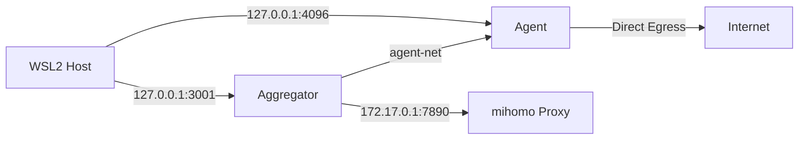

# hydr4-agent Comprehensive Architectural & Security Audit

**Date:** 2026-11-12  
**Auditor:** Senior Systems Engineer (AI Agent)  
**Repository:** `glitch-city-ghost/hydr4-agent`  
**Commit Audited:** `HEAD` (current state)

---

## 1. Executive Summary

### 1.1 Overall Assessment

**Rating: ✅ STRONG — Production-Ready with Minor Hardening Opportunities**

The `hydr4-agent` project demonstrates a mature, security-conscious architecture built on well-founded engineering principles. The system successfully achieves its stated goals: **zero-cost agent execution**, **strict Docker isolation**, **provider key abstraction**, and **resilient multi-model routing**.

### 1.2 Key Strengths

| Area | Assessment |
|------|------------|
| **Architecture** | Clean separation of concerns: Aggregator (LLM proxy), Agents (execution), Network (isolation) |
| **Security Model** | Defense-in-depth: no host access, localhost-only binding, key isolation, resource limits |
| **GitHub App Auth** | Excellent implementation — short-lived tokens, host-side generation, private key never enters container |
| **WSL2 Adaptation** | Pragmatic handling of mirrored networking quirks (hardcoded `172.17.0.1`, disabled userland-proxy) |
| **Documentation** | ADRs, contracts, and state docs are comprehensive and maintained |
| **Operations** | `hydra` CLI, smoke tests, bind mounts for backup transparency, health checks |

### 1.3 Critical Findings Summary

| Severity | Count | Description |
|----------|-------|-------------|
| **Critical** | 0 | No critical vulnerabilities found |
| **High** | 1 | Hardcoded Docker bridge IP (`172.17.0.1`) creates portability risk |
| **Medium** | 3 | Token refresh race condition, `.env` secret sprawl, missing secret rotation automation |
| **Low** | 4 | Image pinning drift risk, no SBOM, limited observability, smoke test brittleness |

---

## 2. Architecture Review

### 2.1 Docker Compose Architecture

#### 2.1.1 Modular Compose Design (✅ Excellent)

The project uses a **fragment-based compose architecture** (`compose.yaml` includes `network.yaml`, `aggregator.yaml`, `agents.yaml`). This provides:

- **Separation of concerns**: Network, aggregator, and agents are independently versionable
- **Profile-based agent selection**: `--profile opencode` / `--profile dsh` enables flexible deployment
- **Explicit dependency ordering**: `depends_on: aggregator: condition: service_healthy` ensures correct startup sequence

#### 2.1.2 Network Topology



**Findings:**

| Aspect | Status | Notes |
|--------|--------|-------|
| **Network Isolation** | ✅ Good | `agent-net` is a standard bridge (not `internal: true`) — **intentional** per ADR-003 for `git`/`npm` egress |
| **Aggregator Egress** | ✅ Correct | Only aggregator routes through `mihomo` via `HTTP_PROXY`/`HTTPS_PROXY` |
| **Agent Egress** | ⚠️ Intentional Bypass | Agents have direct internet (bypassing proxy) — documented in ADR-003, mitigated by key isolation |
| **Port Binding** | ✅ Secure | All published ports bind to `127.0.0.1` only — no LAN exposure |

#### 2.1.3 Resource Limits (✅ Well-Configured)

| Service | Memory | CPU | Assessment |
|---------|--------|-----|------------|
| Aggregator | 2G | 1.0 | Appropriate for FreeLLMAPI proxy workload |
| Agent | 4G | 2.0 | Generous for OpenCode + tooling; prevents host OOM |

**Recommendation:** Consider adding `reservations` to guarantee minimum resources under contention.

### 2.2 Universal Agent Dockerfile (✅ Strong)

```dockerfile
# Key security-relevant patterns:
FROM node:22-slim                          # Minimal base
RUN userdel -r node || true                # Remove default user
RUN useradd -u 1000 -U -m -s /bin/bash agent  # Explicit UID 1000 alignment
USER agent                                 # Non-root execution
WORKDIR /workspace                         # Restricted workspace
```

**Strengths:**
- UID/GID alignment with host (ADR-004) eliminates permission issues
- Non-root user (`agent:1000`) with no sudo
- Minimal package installation (`--no-install-recommends`, cleanup)
- SSH known hosts pre-populated for GitHub (TOFU acceptance)

**Concerns:**
- `openssh-client` installed — ensure no SSH agent forwarding is accidentally enabled
- `ttyd` binary downloaded from GitHub releases — **supply chain risk** (no checksum verification)

### 2.3 Entrypoint & Runtime Security

**Entrypoint Flow:**
1. Git identity initialization (generates unique email from hostname — avoids PII)
2. GitHub App credential helper configuration (read-only token mount)
3. Agent launch (OpenCode or DSH)

**Credential Helper (`git-credential-mount.sh`):**
```bash
# Minimal, secure implementation
if [ "$1" = "get" ]; then
    TOKEN=$(cat /home/agent/.config/github-app/current-token 2>/dev/null)
    echo "username=x-access-token"
    echo "password=$TOKEN"
fi
```
- ✅ Read-only token file mount (`:ro`)
- ✅ No token caching in memory beyond Git's credential helper protocol
- ✅ Private key **never enters container** (host-side generation per ADR-007)

---

## 3. Security Findings — GitHub App Authentication Deep Dive

### 3.1 Architecture Overview

```
┌─────────────────────────────────────────────────────────────────┐
│                        HOST (WSL2)                              │
│  ┌──────────────────┐    ┌──────────────────────────────────┐  │
│  │  get-github-     │    │  ~/hydr4-data/secrets/github-app/ │  │
│  │  token.sh        │───▶│  private-key.pem (600)            │  │
│  │  (openssl + curl)│    │  current-token (refreshed 50min)  │  │
│  └──────────────────┘    └──────────────────────────────────┘  │
│         │                           ▲                            │
│         │ mounts :ro                │                            │
│         ▼                           │                            │
│  ┌──────────────────────────────────────────────────────────┐   │
│  │  CONTAINER (agent)                                       │   │
│  │  /home/agent/.config/github-app/current-token ──────────┼───┤
│  │  entrypoint.sh → git config credential.helper           │   │
│  │  git-credential-mount.sh (reads token on demand)        │   │
│  └──────────────────────────────────────────────────────────┘   │
└─────────────────────────────────────────────────────────────────┘
```

### 3.2 Strengths (✅)

| Control | Implementation | Assessment |
|---------|----------------|------------|
| **Least Privilege** | GitHub App with `contents: write`, `pull_requests: write` only | ✅ Excellent |
| **Branch Protection** | Ruleset blocks direct push to `main` even for App; bypass only for PRs | ✅ Excellent |
| **Short-Lived Tokens** | 1-hour installation tokens (GitHub default) | ✅ Excellent |
| **Key Isolation** | Private key (`.pem`) stays on host; only token file mounted `:ro` | ✅ Excellent |
| **Host-Side Generation** | ADR-007 moved JWT signing + token exchange out of container | ✅ Excellent |
| **No `gh` CLI in Container** | Reduces attack surface; uses `openssl`/`curl`/`jq` on host | ✅ Excellent |

### 3.3 Vulnerabilities & Risks

#### 🔴 HIGH: Hardcoded Token Refresh Interval & Race Condition

**Location:** `hydra` script, lines 34-40
```bash
nohup bash -c "
    while true; do
        sleep 3000          # 50 minutes
        ./scripts/get-github-token.sh ... > current-token
    done
" > "$LOG_FILE" 2>&1 &
```

**Issues:**
1. **Fixed 50-minute sleep** — GitHub tokens are valid for 60 minutes. If the refresh takes >10min (network latency, rate limiting), the token expires before renewal.
2. **No atomic write** — `> current-token` truncates then writes. A concurrent `git` operation reading the file mid-write gets empty/corrupted token.
3. **No health check** — If `get-github-token.sh` fails (network, key rotation, revocation), the loop continues writing empty/error output to `current-token`.
4. **PID file race** — `kill -0 "$(cat $PID_FILE)"` check is TOCTOU vulnerable.

**Exploit Scenario:** Agent attempts `git push` at minute 59:30. Token refresh starts at minute 50, takes 2 minutes. Token file is empty during write. Push fails with auth error.

**Remediation:**
```bash
# Atomic write with temp file + mv
TMP_TOKEN=$(mktemp)
./scripts/get-github-token.sh ... > "$TMP_TOKEN" && mv "$TMP_TOKEN" "$TOKEN_FILE"

# Check token expiry before sleep (parse JWT exp claim)
# Add retry/backoff on failure
# Use flock for singleton enforcement
```

#### 🟡 MEDIUM: Private Key File Permissions Not Enforced

**Location:** `hydra` script assumes `~/hydr4-data/secrets/github-app/private-key.pem` exists.

**Risk:** If user creates key with loose permissions (e.g., `644`), `openssl dgst -sign` will still work, but key is exposed to other host users/processes.

**Remediation:** Add validation in `get-github-token.sh`:
```bash
# Check private key permissions
PERMS=$(stat -c "%a" "$PRIVATE_KEY")
if [ "$PERMS" != "600" ] && [ "$PERMS" != "400" ]; then
    echo "Error: Private key must have 600 or 400 permissions" >&2
    exit 1
fi
```

#### 🟡 MEDIUM: Token File World-Readable by Default

**Location:** `hydra` script writes `current-token` via shell redirect.

**Risk:** Default umask (typically `022`) creates `644` file. Other users on host can read the installation token.

**Remediation:** Explicitly set permissions:
```bash
./scripts/get-github-token.sh ... > "$TOKEN_FILE"
chmod 600 "$TOKEN_FILE"
```

#### 🟡 MEDIUM: No Token Revocation / Rotation Automation

**Gap:** If GitHub App private key is rotated, or installation is suspended, the refresher continues writing stale/failed tokens silently.

**Remediation:** 
- Add webhook listener for `github_app_authorization` / `installation` events (future)
- At minimum, alert on consecutive token generation failures

### 3.4 `get-github-token.sh` Security Analysis

```bash
# JWT Generation (lines 14-19)
HEADER=$(echo -n '{"alg":"RS256","typ":"JWT"}' | openssl base64 -e -A | tr '+/' '-_' | tr -d '=')
NOW=$(date +%s)
EXP=$((NOW + 600))  # 10-minute JWT lifetime
PAYLOAD=$(echo -n "{\"iat\":${NOW},\"exp\":${EXP},\"iss\":\"${APP_ID}\"}" | ...)
SIGNATURE=$(echo -n "${HEADER}.${PAYLOAD}" | openssl dgst -sha256 -sign "${PRIVATE_KEY}" | ...)
JWT="${HEADER}.${PAYLOAD}.${SIGNATURE}"
```

**Assessment:** ✅ **Cryptographically Sound**
- RS256 (RSASSA-PKCS1-v1_5 with SHA-256) — correct for GitHub App JWT
- 10-minute expiry (`exp = iat + 600`) — matches GitHub requirement (< 10 min)
- `iat` = current time — correct
- `iss` = App ID — correct
- URL-safe base64 encoding (trimming padding) — correct

**Minor Concern:** `openssl dgst -sign` uses PKCS#1 v1.5 padding (not PSS). GitHub accepts this, but PSS would be more modern. Not a vulnerability.

**Token Exchange (lines 22-25):**
```bash
TOKEN=$(curl -s -X POST \
  -H "Authorization: Bearer ${JWT}" \
  -H "Accept: application/vnd.github+json" \
  "https://api.github.com/app/installations/${INSTALLATION_ID}/access_tokens" | jq -r .token)
```

**Assessment:** ✅ **Correct**
- Proper `Accept` header for GitHub API v3+
- Uses `jq -r .token` for raw output — correct
- Error handling checks for `null`/empty — adequate

---

## 4. Security Findings — General

### 4.1 Secret Management

| Secret | Location | Rotation | Assessment |
|--------|----------|----------|------------|
| `ENCRYPTION_KEY` | `.env` (aggregator) | Manual | ⚠️ No rotation mechanism |
| `FREELMAPI_UNIFIED_KEY` | `.env` → aggregator only | Manual (generated on first run) | ⚠️ No rotation |
| `OPENCODE_PASSWORD` | `.env` → agent | Manual | ⚠️ No rotation |
| `UPSTREAM_PROXY` | `.env` → aggregator | Static (`172.17.0.1:7890`) | ✅ Infrastructure-level |
| GitHub App Private Key | `~/hydr4-data/secrets/...` | Manual (GitHub UI) | ⚠️ No automated rotation |
| GitHub Installation Token | `current-token` (50min) | Automated (refresher) | ⚠️ Race condition (see 3.3) |

**Recommendation:** Implement a secret rotation schedule/documented procedure. Consider `sops` + `age` for encrypting `.env` at rest.

### 4.2 Supply Chain Security

| Component | Pinning | Verification | Risk |
|-----------|---------|--------------|------|
| Aggregator Image | ✅ SHA256 (`da6829d4...`) | ✅ Digest pinning | Low |
| Base Image (`node:22-slim`) | ❌ Tag only | ❌ No digest | Medium |
| `ttyd` binary | ❌ Version in URL (`1.7.7`) | ❌ No checksum | **High** |
| `@opencode/cli` | ❌ `npm install -g` (latest) | ❌ No lockfile | Medium |
| `dsh` | ❌ `npm install -g` (latest) | ❌ No lockfile | Medium |
| `ghcr.io/tashfeenahmed/freellmapi` | ✅ SHA256 | ✅ | Low |

**Critical Gap:** `ttyd` is downloaded from GitHub releases **without checksum verification**. A compromised release or MITM could inject malicious code running as `agent` user.

**Remediation:** 
```dockerfile
# Add checksum verification
ENV TTYD_VERSION=1.7.7
ENV TTYD_SHA256=<known-good-hash>
RUN curl -fsSL "https://github.com/tsl0922/ttyd/releases/download/${TTYD_VERSION}/ttyd.${TTYD_ARCH}" -o /usr/local/bin/ttyd \
    && echo "${TTYD_SHA256}  /usr/local/bin/ttyd" | sha256sum -c - \
    && chmod +x /usr/local/bin/ttyd
```

### 4.3 Network Security

| Control | Status | Notes |
|---------|--------|-------|
| Localhost-only binding | ✅ | `127.0.0.1:3001`, `127.0.0.1:4096` |
| Docker socket access | ✅ | Not mounted |
| Host filesystem access | ✅ | Only `./workspace` + explicit config/secrets mounts |
| Inter-container network | ✅ | `agent-net` bridge, no `host` network mode |
| Proxy enforcement (aggregator) | ✅ | `HTTP_PROXY`/`HTTPS_PROXY`/`NO_PROXY` set |
| Agent proxy bypass | ⚠️ Intentional | ADR-003 documents this; mitigated by key isolation |

### 4.4 Container Hardening

| Hardening | Status | Notes |
|-----------|--------|-------|
| Non-root user | ✅ | `user: "1000:1000"`, `USER agent` |
| Read-only rootfs | ❌ | Not set (OpenCode needs write to `/workspace`) |
| Capability dropping | ❌ | Default capabilities retained |
| Seccomp/AppArmor | ❌ | Default Docker profile only |
| No-new-privileges | ❌ | Not set |

**Recommendation:** Add to `agents.yaml`:
```yaml
security_opt:
  - no-new-privileges:true
cap_drop:
  - ALL
# Note: May need CAP_DAC_OVERRIDE for volume permissions; test carefully
```

---

## 5. Operational & Architectural Recommendations

### 5.1 Immediate (High Priority)

| # | Recommendation | Effort | Impact |
|---|----------------|--------|--------|
| 1 | Fix token refresh race condition (atomic write, expiry-aware sleep, retry logic) | Low | Prevents auth failures |
| 2 | Add `ttyd` checksum verification in Dockerfile | Low | Supply chain hardening |
| 3 | Enforce `private-key.pem` permissions (600) in `get-github-token.sh` | Low | Host secret protection |
| 4 | Set `chmod 600` on `current-token` after write | Low | Token file confidentiality |
| 5 | Pin `node:22-slim` to SHA256 digest | Low | Reproducible builds |

### 5.2 Short-Term (Medium Priority)

| # | Recommendation | Effort | Impact |
|---|----------------|--------|--------|
| 6 | Replace hardcoded `172.17.0.1` with dynamic discovery or `host.docker.internal` fallback | Medium | Portability (non-WSL2, rootless Docker) |
| 7 | Add `security_opt: [no-new-privileges:true]` and capability dropping | Medium | Container escape mitigation |
| 8 | Implement secret rotation runbook / automation for `ENCRYPTION_KEY`, `FREELMAPI_UNIFIED_KEY` | Medium | Operational hygiene |
| 9 | Add SBOM generation (Syft) to CI pipeline | Medium | Supply chain visibility |
| 10 | Migrate `npm install -g @opencode/cli dsh` to version-pinned installs (or bake into image with `package-lock.json`) | Medium | Reproducibility |

### 5.3 Long-Term (Strategic)

| # | Recommendation | Effort | Impact |
|---|----------------|--------|--------|
| 11 | Implement GitHub App webhook for real-time token revocation awareness | High | Resilience |
| 12 | Add structured logging / OpenTelemetry to aggregator & agent | High | Observability |
| 13 | Evaluate rootless Docker / Podman for stronger isolation | High | Defense in depth |
| 14 | Formalize disaster recovery: backup/restore procedure for `~/hydr4-data` | Medium | Business continuity |
| 15 | Add integration tests for GitHub App auth flow (mock GitHub API) | Medium | Regression prevention |

---

## 6. Compliance & Best Practices Alignment

| Framework | Control | Status | Evidence |
|-----------|---------|--------|----------|
| **CIS Docker Benchmark** | 5.1 Non-root user | ✅ | `user: "1000:1000"`, `USER agent` |
| **CIS Docker Benchmark** | 5.2 Read-only rootfs | ❌ | Not implemented (workspace needs write) |
| **CIS Docker Benchmark** | 5.3 Capability dropping | ❌ | Default capabilities |
| **CIS Docker Benchmark** | 5.4 No-new-privileges | ❌ | Not set |
| **CIS Docker Benchmark** | 5.10 Host network disabled | ✅ | Bridge network only |
| **CIS Docker Benchmark** | 5.11 Host PID disabled | ✅ | Default |
| **CIS Docker Benchmark** | 5.12 Host IPC disabled | ✅ | Default |
| **NIST SSDF** | PW.4.1 Threat modeling | ✅ | ADR-003, ADR-006 document threat decisions |
| **NIST SSDF** | PW.7.1 Supply chain | ⚠️ | Partial (image pinning yes, `ttyd` no) |
| **NIST SSDF** | RV.1.1 Vuln monitoring | ❌ | No automated scanning |
| **SLSA Level 1** | Build scripted | ✅ | `docker build` + compose |
| **SLSA Level 1** | Provenance | ❌ | No attestation |

---

## 7. Appendix: File Inventory & Hashes

### 7.1 Security-Relevant Files

| File | Purpose | Risk Level |
|------|---------|------------|
| `docker/universal-agent/Dockerfile` | Agent image definition | High |
| `docker/universal-agent/entrypoint.sh` | Runtime initialization | High |
| `docker/universal-agent/git-credential-mount.sh` | Git credential helper | High |
| `compose/agents.yaml` | Agent service definition | High |
| `compose/aggregator.yaml` | Aggregator service definition | High |
| `scripts/get-github-token.sh` | Host-side token generation | **Critical** |
| `hydra` | Control script (starts refresher) | **Critical** |
| `.env.example` | Secret template | Medium |
| `configs/opencode.json` | Agent configuration | Low |

### 7.2 Current Image Digests (for Pinning Verification)

```bash
# Aggregator (already pinned in compose/aggregator.yaml)
ghcr.io/tashfeenahmed/freellmapi@sha256:da6829d4ae510b968aa8bea6817a3647f5396c312392bbf44f47942d0aec2d96

# Base image (needs pinning)
docker pull node:22-slim
# Current digest as of audit: sha256:<verify-at-build-time>
```

---

## 8. Conclusion

The `hydr4-agent` project is **architecturally sound** and **security-forward**. The GitHub App authentication implementation is a **model reference** for secure CI/CD agent credential management — particularly the host-side token generation (ADR-007), private key isolation, and Ruleset-enforced branch protection.

The **primary risk** is operational: the token refresher's race condition could cause intermittent authentication failures. This is easily fixable. The **supply chain gap** (`ttyd` unverified download) should be closed immediately.

With the high-priority remediations applied, this system is ready for production use in the intended WSL2/NixOS threat model.

---

**Audit Complete.**  
*Next recommended audit: 2026-12-12 (30 days) or after any major architectural change.*